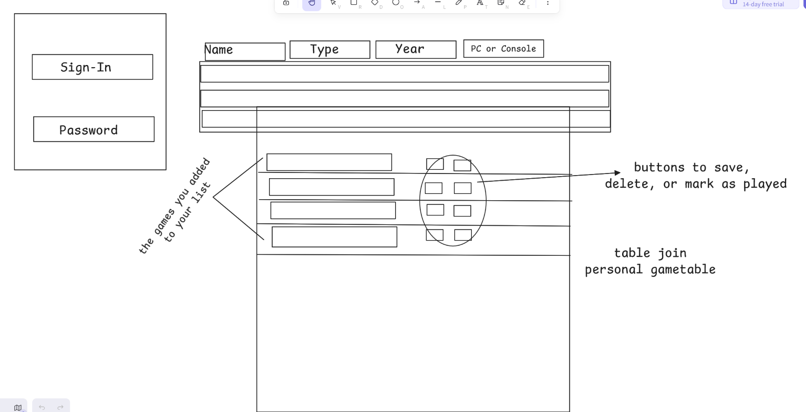

# Your App's Name
To Be Played (TBP)

## The problem
An app to keep track of the games the user has played and wants to play.

## Persona
- Name and situation:
- Frustration: not keeping track of the games the user has or has not played.
- Goal: making a list to keep track of games
- When they'd open the app: they will see the search

## Scope

### In this version
1. A visitor sees the search bar.
2. A visitor adds a game.
3. mark the game as played or to be played

### Left out, and why
- logging in, needed more time

## The table
Table: `games`

| Column | Type | Example value |
| --- | --- | --- |
| `title` | `text` | a way out|
| `genre` | `text` | action-adventure |
| `year` | `int4` |2018 |

`id` and `created_at` are made for you.

### What a visitor can do
- create a list of games 
- Add a game to the list they have already played.
- add a game to a "wishlist" to play.

## The table 2

| Column | Type | Example value |
| --- | --- | --- |
| `gameid` | `int8` | 8|
| `played` | `bool` | true |
| `wishlist` | `bool` |true |

## The plan

### Sections
- a search bar to look for games.
- The table will allow the user to have games they played and want to play.

## System
- The visitor: will search games
- The app drop down menu to show all games narrowing down the results while typing
- While loading: ༄˖°.🍃.ೃ࿔*:･Loading༄˖°.🍃.ೃ࿔*:･
- If nothing matches: ☆.𓋼𓍊 𓆏 𓍊𓋼𓍊.☆Error:
- If it fails: 𓅰 𓅬 𓅭 𓅮 𓅯No games found.𓅰 𓅬 𓅭 𓅮 𓅯

## Reflection: the plan

## What changed
the way the user saves games has changed

## AI use
pictures, used to clear up confusion on some issues.

## Links
- Live: https://capstone-lv3.netlify.app/
- Repo: https://github.com/Hexaxolotl/capstone-lv3

## Team
Pod: @FrankCastle-Arch, @mattwainwright-dev, @CharityCP

## Pod plan
https://docs.google.com/document/d/1mQySxORC2Bp30ZHNkmuCxnYR95Vv0X6jM_2CmppKQQk/edit?usp=sharing
