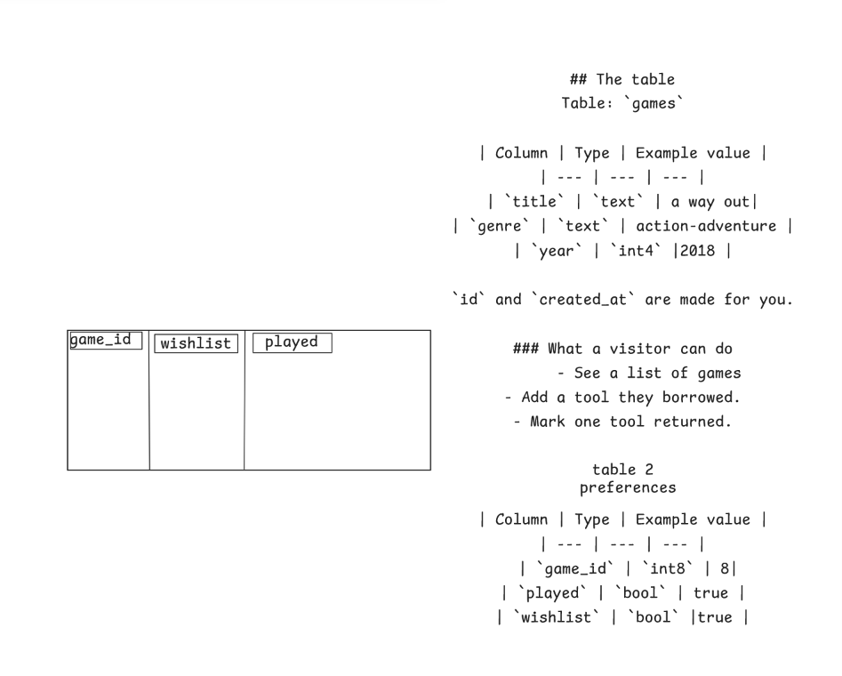

# Your App's Name

## The problem
An app to keep track of the games the user has played and wants to play.

## Persona
- Name and situation:
- Frustration:
- Goal:
- When they'd open the app:

## Scope

### In this version
1. A visitor sees the list.
2. A visitor adds a row.
3. Your own line.

### Left out, and why
- A feature, and why it waits.
- Another feature, and why it waits.

## The table
Table: `games`

| Column | Type | Example value |
| --- | --- | --- |
| `title` | `text` | a way out|
| `genre` | `text` | action-adventure |
| `year` | `int4` |2018 |

`id` and `created_at` are made for you.

### What a visitor can do
- create a list of games 
- Add a game to the list they have already played.
- add a game to a "wishlist" to play.

## The table 2

| Column | Type | Example value |
| --- | --- | --- |
| `gameid` | `int8` | 8|
| `played` | `bool` | true |
| `wishlist` | `bool` |true |

## The plan

### Sections
- A table for the user to add games to.
- The table will allow the user to have games they played and want to play.

## System
- The visitor:
- The app:
- The visitor sees:
- While loading:
- If nothing matches:
- If it fails:

## Reflection: the plan

## What changed

## Reflection: feedback

## Reflection

## AI use

## Links
- Live: https://capstone-lv3.netlify.app/
- Repo: https://github.com/Hexaxolotl/capstone-lv3

## Team
Pod: @FrankCastle-Arch, @mattwainwright-dev, @CharityCP
Pod plan: your pod's Google Doc link
